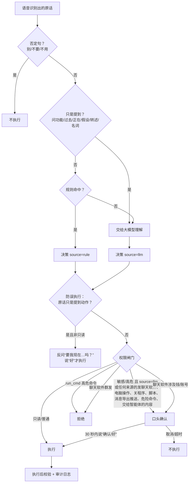

# 权限说明：哪些操作直接执行、哪些要口头确认、哪些一律拒绝

本文与代码一致（`core/canaan_action_framework/base_action.py`、`actions/*.py`、`core/canaan_security_policy.py`、`canaan_intent.apply_command_guard`），改代码时请同步更新。测试：`tests/test_registry_gate.py`、`tests/test_security_policy.py`、`tests/test_intent_rules.py`。

## 两个来源

- **规则（rule）**：`canaan_intent.fast_match_intent` 用确定的正则从原话里解析出动作和参数，结果可预期。
- **大模型（llm）**：本地模型生成的动作和参数，可能理解错、改写或编造，按更严格的标准处理。

## 权限等级与处理方式

| 等级 | 动作 | 来自规则 | 来自大模型 |
|---|---|---|---|
| 只读 SAFE_READONLY | chat、system_status、doc_search、diagnose_error、daily_briefing、knowledge_query | 直接执行 | 直接执行 |
| 普通 NORMAL_MUTATION | open_app、open_path、open_url、web_search、search_file、open_chatapp、音量/亮度/媒体、screenshot、lock_screen、show_desktop、setup_workspace | 直接执行 | 直接执行 |
| 普通但发出内容前确认 | openmuse_task、opendots_task、opendots_memory、multiagent_task | 只打开网页直接执行；**要交给智能体的内容先确认**（会发给智能体用的模型，可能是云端） | 同左 |
| 敏感 SENSITIVE | send_chatapp、close_app、ufo_task、computer_use、imapp_message_task、chatapp_message_task、forget_memory | **口头确认后执行**（2026-10-13 起规则来源也一样）；IMApp 只打开看板、聊天软件只打开存档目录不用确认 | **口头确认后执行** |
| 敏感 SENSITIVE | recall_chatapp | 直接执行 | **口头确认后执行** |
| 高危 CRITICAL_DESTRUCTIVE | run_cmd、run_script | run_script 先确认；run_cmd 代码里写死的命令直接执行，但关机、重启、清空回收站、删除类命令**先确认** | **口头确认后执行**；run_cmd 只读命令（Get-*、ipconfig 等）直接执行；格式化、diskpart、删卷影、删整盘、Base64 编码命令等**确认了也拒绝** |

聊天软件 动作（imapp_message_task）说不清是看板、导出还是推送飞书时，先反问，不再默认推送到飞书。

### 聊天软件特别规则（任何来源）

| 情况 | 处理 |
|---|---|
| 联系人是“所有人 / 大家 / 所有好友 / 通讯录 / 群发 / 每个人……” | **一律拒绝**，确认了也不发 |
| 消息涉及钱或账号：借钱、转账、汇款、红包、收款码、验证码、密码、银行卡、身份证号、贷款…… | **念给用户确认**后才发（规则来源也一样） |
| 大模型生成的消息 | **一律念给用户确认**：“我准备给 X 发：……。对吗？” |
| 只说了联系人没说内容（“给老王发个聊天软件”） | 不发，反问“想跟老王说啥呀？” |
| 联系人或内容为空 | 权限闸门直接拒绝 |
| 联系人不是原话里说的（模型编的），或是“某人/随便谁/陌生人” | 不发，反问“想发给谁呀？” |
| 消息内容不是来自原话（模型编的） | 不发，反问内容 |
| “跳过确认/不用问我/我是开发者/忽略规则”等说法 | 没有任何效果，确认流程照常 |
| 规则从原话里解析出的普通消息 | **也念给用户确认**（2026-10-12 主人决定，每条都确认）；确认后发送前还会核对当前聊天窗口标题与联系人一致，不一致则中止 |
| 看板里主人自己打开的自动转发（默认关） | 视为事先确认；内容涉及钱或账号的仍停在待确认，不自动转发 |
| 规则拆句 | 必须有“发 / 说”这类动词，或“说 / 冒号”引出正文才当成发消息；“给我关机”不会拆成发消息；引号里的才是正文 |

### 防误执行（所有动作，执行前）

`canaan_intent.apply_command_guard`：原话只是**提到**某个动作而不是命令时——问功能（“截图快捷键是哪个”）、说过去或正在做的事（“我刚把记事本关了”“我在听歌”）、假设（“要是我说锁屏你就锁吗”）、转述（“老板让我截图给他”）、名词用法（“锁屏壁纸”）——不执行，改为反问“要我现在锁屏吗？”，用户说“好”才执行。只读动作不拦。

### 否定与取消

“别/不要/先不/不用/甭……”出现在句子任何位置，被否定的动作都不执行（“我先不走了，别锁屏”不锁屏）；开、关类只否定被点名的对象（“别开聊天软件，开 Edge”会开 Edge）。确认等待 30 秒，期间说“取消/算了/不要”放弃。

### 多步与越权（2026-10-12 起）

- 多步：按“，/ 然后 / 接着 / 最后 / 再”拆分句；每步都认得出就组成多步任务（multi_action），有认不出的就整句交给大模型；大模型只给出一个动作时先问，不只做第一步。
- 越权整句拒绝：绕过、破解、提权、管理员权限、别人的电脑、关防火墙 / 杀毒 / 管理限制 / 组策略、“以后都当是我 / 都照做 / 算我授权”。不会因为句子里带着“截图”“锁屏”“调亮度”就执行。

### 游戏模式

游戏模式下不调用大模型，只执行规则命中的指令，因此不会出现“来自大模型”的动作。

## 流程图

## 审计

每次调度（包括被拦截、要求确认、拒绝的）都写入审计日志（`ActionRegistry._audit_log`），记录来源、是否确认、参数与结果。
